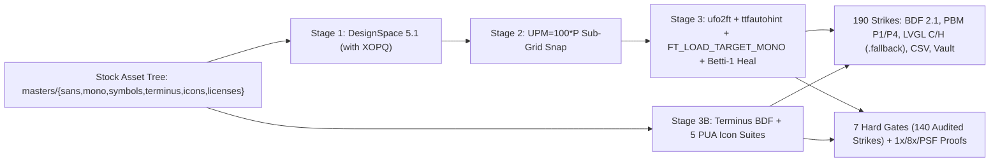

# `epd-font` v2.1.0 — EPD Bi-Level Typography System (`SPEC-EPD-FONT-001 Rev 1.1`)

A 1-bit (`LV_COLOR_FORMAT_I1`) Electrophoretic Display (EPD) typography pipeline built on **self-contained stock UFO 3 masters** (`masters/`), **DesignSpace 5.1** XML, **sub-grid coordinate snapping (`UPM = 100 * P`)**, **FreeType `FT_LOAD_TARGET_MONO`** rasterization, **Terminus** bitmap small-size strikes, **PUA Icon Suites** with LVGL `.fallback` chains, and **7 quantitative pass/fail gates**.

---

## 1. Architecture Overview



---

## 2. Optical-Floor Proportional Scaling Law

- **Optical Floor (`12 px - 16 px`):** Clamps vertical stems to `2 px` (`normal`/`italic`) and `3 px` (`bold`/`bold-italic`) to prevent lateral microcapsule scattering washout.
- **Proportional Scaling (`18 px - 40 px`):** Scales stems linearly with PPEM $P$:

$$
S_{\text{norm}}(P) = \max\bigl(2,\; \text{round}(0.11 \times P)\bigr)\text{ px}
$$

$$
S_{\text{bold}}(P) = \max\bigl(3,\; S_{\text{norm}}(P) + 1,\; \text{round}(0.17 \times P)\bigr)\text{ px}
$$

---

## 3. Isolated Python 3.12 Environment & CLI Usage

All Python tools run strictly inside `<repo>/.venv` (`Python 3.12`, `PYTHONNOUSERSITE=1`) to avoid conflicts with system Python installations.

```powershell
# 1. Provision .venv (once)
powershell -ExecutionPolicy Bypass -File scripts\setup_venv.ps1

# 2. Verify environment isolation
scripts\epd_font.bat --check-env

# 3. Run full 190-strike build (120 UFO + 20 Terminus + 50 Icons), LVGL .fallback C/H, 140-strike audit, and PSF proofs
scripts\epd_font.bat all
```

Available CLI subcommands (`scripts\epd_font.bat <cmd>`):
- `normalize`: Verify self-contained `masters/{sans,mono,symbols,terminus,icons,licenses}/` stock asset tree (`--force` to rebuild from donors if present).
- `designspaces`: Emit `designspaces/epd_<P>px.designspace` (`format="5.1"`, including `XOPQ` optical stem axis).
- `calibrate`: Sweep per-PPEM axis coordinates in `config/sizes/ppem_<P>.yaml`.
- `build`: Compile, sub-grid snap, hint, rasterize, Betti-1 pinhole heal, and serialize `BDF`, `PBM`, `LVGL C/H` (with static `.fallback` + runtime `epd_font_bind_fallback()`), `CSV`, and `humid1_epd_vault.json.gz`.
- `audit` / `proofs`: Evaluate all 7 gates (`G_STEM`, `G_CONTRAST`, `G_COUNTER`, `G_METRICS`, `G_MONO`, `G_CLIP`, `G_PINHOLE`) across 140 strikes (`120` UFO + `20` Terminus) and emit `build/proofs/AUDIT.md`, `specimen_1x.pbm`, `grid_8x.png`, and `epd_psf_sim.png`.
- **BDF/PBM Inspector CLI:** `.venv\Scripts\python.exe tools\agent\tools\bdf_info.py <bdf_path> [--compare <other.bdf>]` and `pbm_info.py <pbm_path>` (also exposed via `embedded-ops` MCP tools `epd_inspect_bdf` and `epd_inspect_pbm`).
